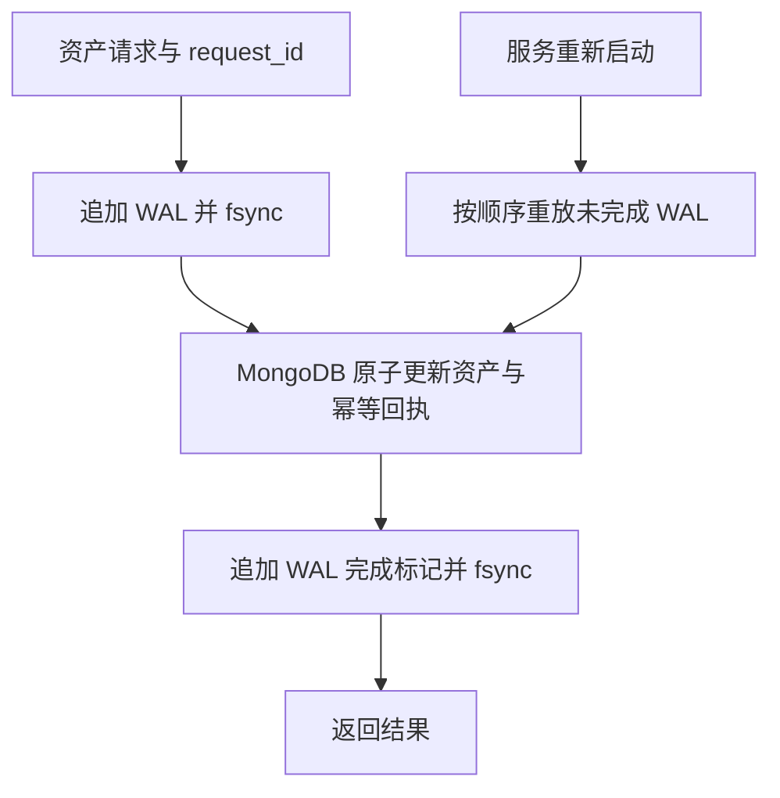

# GPT · 游戏资产与持久化实验

使用 Go 和 MongoDB 实现游戏资产后端，探索金币、背包、请求幂等和崩溃恢复。

## 项目入口

| 项目 | 内容 | 文档 |
| --- | --- | --- |
| [wal-demo](wal-demo/) | 玩家创建、金币奖励、道具购买，以及基于 WAL 的恢复 | [启动与接口说明](wal-demo/README.md) |

当前 Demo 为单进程、本地开发示例，尚未实现登录鉴权、跨玩家交易、日志压缩与回执清理。

## 快速运行

在此云环境中，从仓库根目录执行（需要本机 Docker 可用）：

```bash
cd wal-demo
bash scripts/setup.sh
bash scripts/mongo.sh
source scripts/env.sh
./bin/game-server
```

安装脚本针对 Linux amd64，安装经 SHA-256 校验的 Go 1.27.3；MongoDB 使用固定摘要的官方镜像。工具链和缓存位于 `/workspace`，详细环境变量见 [Demo 文档](wal-demo/README.md#启动)。

另开终端，从仓库根目录执行：

```bash
cd wal-demo
python3 scripts/smoke.py
```

功能检查会创建一个独立玩家，验证购买、奖励、余额不足和重复请求。完整调用示例见 [API 文档](wal-demo/README.md#调用接口)。

## 写入与恢复



数据库已经提交、但 WAL 尚未标记完成时，重放通过幂等回执返回原结果，不再重复扣款或发奖。返回 `503` 的操作也可能已提交，重试必须保持原 `request_id` 和参数。

WAL 和 MongoDB 数据都需要保留；这里只重放未完成记录，WAL 不代替数据库备份。详见 [一致性说明与限制](wal-demo/README.md#wal-和资产一致性)。

## 开发验证

在 `wal-demo/` 下执行：

```bash
source scripts/env.sh
bash scripts/mongo.sh
MONGO_TEST_URI=mongodb://127.0.0.1:27017 go test -race -count=1 ./...
go vet ./...
go build -o bin/game-server ./cmd/server
```

未设置 `MONGO_TEST_URI` 时，MongoDB 集成测试会跳过。修改文档不需要重跑应用测试，应检查路径、命令与实现是否一致。

## 仓库约定

每个 Demo 使用独立子目录。当前 Go 模块位于 `wal-demo/go.mod`，仓库根目录不是 Go 模块。

面向编码助手的开发指引见 [AGENTS.md](AGENTS.md)。
