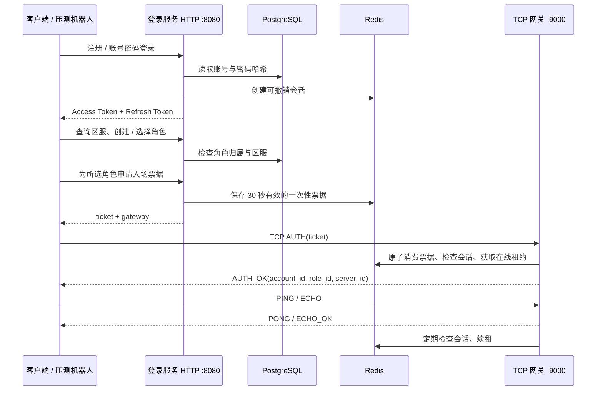

# 架构与接入流程

本项目提供账号、角色和接入网关的完整最小闭环。登录服务使用 HTTP，游戏长连接使用自定义 TCP 协议。网关目前实现身份绑定、心跳和 Echo 示例，接入真实游戏逻辑时，需要在已认证的消息处理入口增加路由与服务调用。

## 服务职责

| 组件 | 职责 | 持久性 |
| --- | --- | --- |
| `cmd/login` | 注册、账号认证、令牌刷新与撤销、区服与角色、签发入场票据 | 账号和角色写入 PostgreSQL |
| `cmd/gateway` | TCP 解帧、入场认证、在线互斥、心跳与示例消息处理 | 在线状态写入 Redis |
| `cmd/robot` | 准备账号与角色、连接与认证、按设定速率发包、生成结果报告 | 报告由调用者保存 |
| `cmd/migrate` | 显式执行版本化数据库迁移 | 数据库中记录迁移版本 |
| PostgreSQL | 账号、密码哈希、角色、唯一性约束 | 需要备份与恢复策略 |
| Redis | 会话、刷新令牌哈希、一次性票据、在线租约、限流计数 | 丢失状态会导致会话失效与重新登录 |

`internal/core` 定义存储接口；生产实现使用 PostgreSQL 与 Redis。内存实现用于测试，不应替代跨进程共享状态。

## 身份与会话

1. 密码使用 bcrypt 保存。默认成本为 12；密码为 12–72 字节，避免 bcrypt 截断长密码。
2. Access Token 是带签名的短期 JWT，默认有效 15 分钟。验证签名、签发方、受众和有效期，并检查 Redis 会话是否仍存在。
3. Refresh Token 默认有效 7 天。服务端只保存其哈希；刷新时原子替换哈希，旧令牌不能再次使用。
4. 退出登录删除当前会话。后续 HTTP 认证失败；网关在定期会话检查时断开连接，默认检查间隔为 5 秒。依赖调用超时、网络与调度延迟可能延长实际断开时间。
5. 网关只接收一次性入场票据。票据绑定账号、所选角色、区服和会话，默认 30 秒过期；原子消费后无法重放。TCP 断开后需要申请新票据重连。

角色归属由登录服务从存储中校验，客户端不能通过提交别人的角色 ID 获得票据。每个账号在每个区服最多创建 5 个角色；同一区服角色名唯一，数据库事务处理并发创建。

## 在线互斥与故障处理

网关为“账号 + 区服”获取 Redis 在线租约，多个网关实例共享这份状态。已有有效租约时，新连接的入场请求失败。租约绑定随机持有者标识，续租和释放均比较该标识，避免旧连接误删新连接的租约。

默认租约为 15 秒，每 5 秒续租。正常断开会主动释放；进程异常退出后由 TTL 回收。网关无法验证会话或无法续租时关闭连接。Redis 故障时认证和入场失败，不降级为绕过认证。生产环境还需要在真实游戏逻辑层校验连接世代或租约栅栏，避免网络分区及进程长时间暂停带来的旧请求执行问题。

每条 TCP 连接有报文尺寸、认证超时、读写超时和消息速率限制；网关还有连接总数上限。响应写入受到写超时限制，避免慢客户端无限占用资源。TCP 帧在读取消息体前校验长度，使用完整读取处理拆包与粘包。

## 扩展为真实游戏后端

在网关完成认证后，连接上下文已经绑定 `account_id`、`role_id`、`server_id` 和会话。可以在此增加消息类型与路由表，把消息转发给场景服、战斗服或大厅服。

建议由游戏逻辑服务再次检查角色与区服上下文、消息权限、顺序以及业务幂等键。涉及金币、背包和交易的写操作必须由权威服务执行，不能信任客户端上报的最终状态。若要重连恢复，需要另外设计连接世代、服务端确认序号、去重窗口与可恢复会话，本项目当前的序号用于单条连接的严格递增校验。

区服列表当前为配置驱动的单区服示例。多区服生产部署应接入区服目录、维护状态、网关发现和调度；网关扩容时，登录服务签发的地址应指向对应区服可达的 TCP 负载均衡入口。
